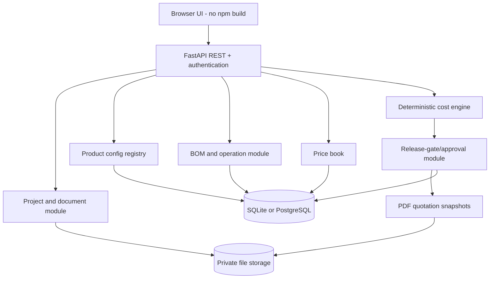
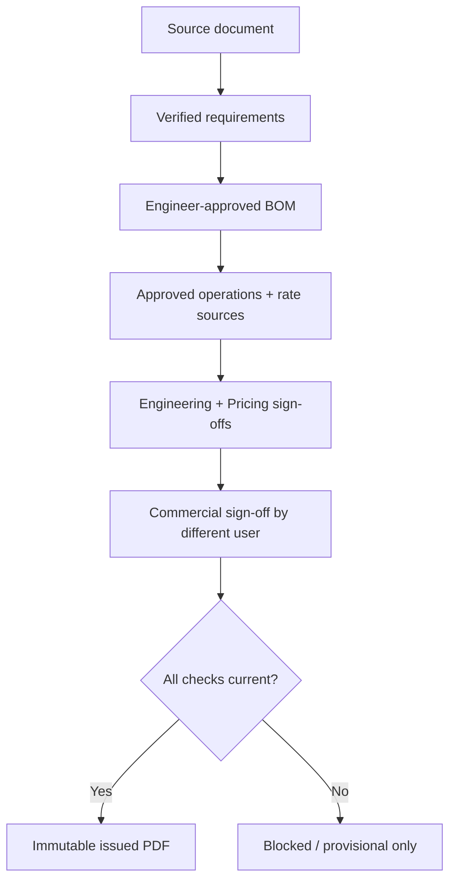

# Architecture — IndustriQuote v0.1

## Design priorities

- Web-first, local/private-first, no paid external APIs.
- One configurable costing engine for multiple product families.
- Facts from sources, estimates, and approvals remain distinct.
- Technical engineering rules are separately validated; this core module does not certify safety-critical equipment.
- Rate edits or BOM changes cannot mutate prior issued quotation PDFs.

## Configuration model

A versioned product definition supplies:
- `product_type`, `label`, `config_version`
- `required_fields`: keys, labels, units, and firm-required flags
- `allowed_components`: SKU allow-list, or empty for unrestricted manual SKU selection
- `required_operations`: operation codes that must be present and approved for firm release
- `requires_document`: whether a source PDF must be uploaded
- `firm_release_enabled`: currently false for the crane schema-only pack

The app does **not** execute user-authored Python/JS formulas. Product configuration is declarative. The material conversion engine implements only defined dimensional conversions and nominal steel-section mass for documented standard shapes.

For new product families, Admin can create a new config through the UI. Updating an existing definition after active jobs exist is intentionally unsupported in v0.1, to avoid retroactively changing historical quotation logic. A future release will store immutable config versions and allow project migration only by explicit user action.

## Pricing rules and precision

- Python `Decimal` for unit rates, waste, conversion and margin.
- Material cost = quantity × (1 + waste%) × unit conversion × effective rate.
- Labour cost = approved operation hours × hourly rate.
- Modelled cost = material + labour + overhead + contingency.
- Unit selling price before tax = cost ÷ (1 − margin%).
- Order value = unit selling price × order quantity (with exact pre-rounded Decimal in calculation).
- Unit conversion from `m`/`m²` to `kg` is a *theoretical model* for supported steel cross-sections, not the vendor's certified weight.
- No default missing price of zero: SKU not found or unit incompatible produces a validation error.
- Rate provenance is stored with each live estimate fingerprint; issued snapshots contain frozen outputs.

## Release model

A requirement update resets that field to `PENDING`. BOM modifications reset quantity status to `ASSUMED`, and operation modifications reset operation status. Each sign-off includes a checksum of the current configuration, requirements, BOM, document hashes, rates and commercial settings. If any of these inputs change, the existing sign-off does not count as current.

**Important distinction:** The `APPROVED` status means a designated employee attested the record. The system does not independently prove the engineering or supplier source is valid.

## API surface

| Area | Routes |
| --- | --- |
| Identity | `POST /api/auth/login`, `GET /api/me`, admin user routes |
| Product packs | `GET /api/configs`, `POST /api/configs` |
| Price book | `GET /api/prices`, `POST /api/prices`, `PUT /api/prices/{sku}` |
| Projects | `GET /api/projects`, `POST /api/projects`, `GET /api/projects/{id}` |
| Settings | `PUT /api/projects/{id}/settings` |
| Requirements | `PUT /api/projects/{id}/requirements/{key}`, `POST .../approve` |
| BOM | `POST .../bom`, `PUT/DELETE .../bom/{line}`, `POST .../bom/{line}/approve`, `POST .../bom/import` |
| Operations | `POST .../operations`, `PUT/DELETE .../operations/{line}`, `POST .../operations/{line}/approve` |
| Documents | `POST .../documents`, authenticated `GET .../documents/{id}/file` |
| Quote | `GET .../preview.pdf`, `POST .../approve/{kind}`, `POST .../issue`, `GET .../issued/{id}.pdf` |
| Audit | `GET .../audit` |

Most mutation endpoints are restricted to specific roles and audited. There is no unapproved outbound sending functionality.

## Data entities

`users`, `product_configs`, `prices`, `projects`, `requirements`, `bom_lines`, `operations`, `documents`, `approvals`, `issued_quotes`, `audit`.

The MVP uses SQLAlchemy metadata creation without migration scripts. Before evolving the schema in a live deployment, adopt Alembic and a tested migration/rollback strategy.

## Runtime choices

- **Local development:** SQLite DB and filesystem storage under `runtime/`. Zero external cost.
- **LAN pilot:** same code on an existing approved server with HTTPS, access controls, backups and network isolation.
- **PostgreSQL:** Docker Compose supplies an optional free PostgreSQL instance, without managed cloud.
- **Future cloud:** same backend can run on a VM; not dependent on a particular host.

Use a reverse proxy for TLS and connection limits if serving beyond localhost. The provided Compose binds to loopback only by design.

## v0.3 extension: extracted requirements vs selling-price domain

v0.3 adds `backend/extraction.py` for local, configuration-driven source candidates and `backend/commercial.py` for independent customer sales quotations. The existing BOM/cost engine remains a private estimator. `CommercialProfile`, `CustomerLine` and `FieldResolution` are additive tables.

Commercial approvals fingerprint specifications, line amounts, tax policy, terms, source documents and source-conflict resolutions. This prevents approval reuse after those inputs change. Issued PDF bytes and snapshots remain immutable. For workflow-specific design and extraction reliability rules see `docs/EXTRACTION_CONFIDENCE_AND_VERIFICATION.md` and `RELEASE_NOTES_v0.3.md`.
